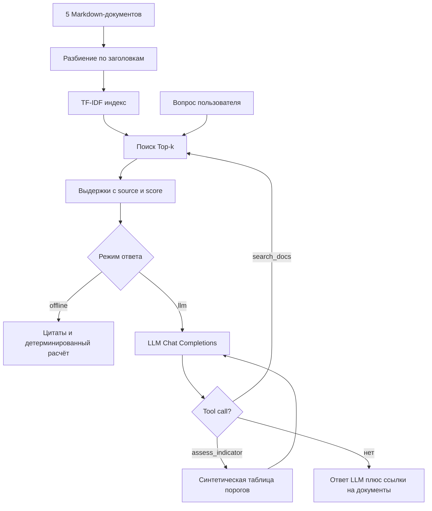
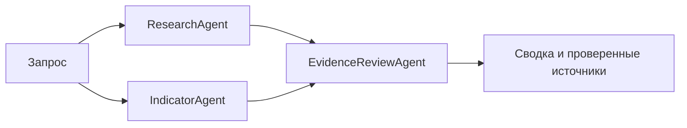

# Архитектура

## Поток RAG

**Примечание:** TF-IDF — лексический retrieval; необязательные Sentence Transformers дают семантический поиск. Список источников формируется сервисом из действительно найденных фрагментов и результатов инструментов, а не только из ответа LLM.

## Multi-agent роли

`ResearchAgent` ищет доказательства. `IndicatorAgent` рассчитывает только заданные условные пороги. `EvidenceReviewAgent` убеждается, что имена документов принадлежат локальной базе знаний. Все эти роли детерминированные, не заменяют LLM-агентов.

## Защита и допущения

1. Нет инструмента исполнения Python, shell, сетевых вызовов по произвольному URL или файловой записи.
2. Источники находятся только в локальном каталоге `knowledge`; пользователь не может загружать произвольный URL в поиск.
3. Числовая оценка из `risk_thresholds.json`, а не из текста, который могла выдумать LLM.
4. Схемы Pydantic проверяют длину запроса, число результатов и конечность чисел.
5. API-ключ не хранится в Git. `/ask` с `mode=offline` не обращается к внешним LLM.
6. Содержимое документов считается недоверенными данными; системная инструкция запрещает исполнять их команды. Это базовая защита, **не гарантия** от всех prompt injection.
7. Пороговые значения вымышлены. Никакие выводы нельзя применять к реальным ESG/операционным рискам без экспертной проверки.
